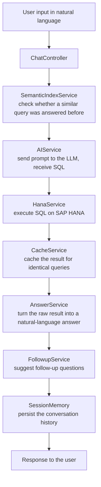

# D.A.V.I.S: Data Analytics & Voice Intelligence System

Enterprise chatbot that translates natural-language questions into SAP HANA SQL, so that non-technical users can query financial data through a conversation.

## What This Does

Reporting on ERP data usually needs someone who knows the database schema and SQL. D.A.V.I.S (Data Analytics & Voice Intelligence System) lets business users ask their question in plain language instead: a large language model generates the SAP HANA SQL, the system executes it and returns the result as a readable answer with suggested follow-up questions.

University project in collaboration with Windhoff Group.

- **Natural Language to SQL (NL2SQL)**: LLM-powered translation of plain-text questions into SAP HANA-compatible SQL
- **Conversational Context**: session-based memory keeps track of follow-up questions across a dialogue
- **Semantic Index (LlamaIndex)**: re-uses successful past queries via local HuggingFace embeddings (no OpenAI key required)
- **Caching Layer**: avoids redundant DB and AI calls; significantly reduces response times on repeated queries
- **Follow-Up Suggestions**: automatically proposes relevant next questions after each answer
- **Clean Chat UI**: lightweight HTML/JS frontend served directly by the backend
- **Health Endpoint**: `/health` for monitoring HANA connectivity and model status

## Architecture

## Tech Stack

- **Backend:** FastAPI, Uvicorn, Pydantic v2, HTTPX (async, HTTP/2)
- **LLM:** Windhoff Group LLM gateway (OpenAI-compatible API)
- **Semantic memory:** LlamaIndex with `sentence-transformers/all-MiniLM-L6-v2` embeddings
- **Database:** SAP HANA (in-memory, cloud-hosted)
- **Frontend:** HTML, CSS, JavaScript (served as a static file)
- **Configuration:** `python-dotenv`, Pydantic Settings

## How It Works

### Design decisions

- **Modular service design**: each component has a single responsibility; swap out the LLM provider or database without touching other layers
- **LlamaIndex semantic memory**: uses local `sentence-transformers/all-MiniLM-L6-v2` embeddings (fully offline, no OpenAI key needed for this layer)
- **MockLLM fallback**: LlamaIndex runs with a MockLLM to avoid any external API dependency for the semantic index
- **Caching algorithm**: LRU-style cache with "last used" marking; reduces repeated DB/AI load
- **Session isolation**: each browser session maintains its own conversation context

### API endpoints

| Method | Endpoint | Description |
|---|---|---|
| `GET` | `/` | Serves the chat frontend (`index.html`) |
| `GET` | `/health` | Returns HANA connectivity status and model info |
| `POST` | `/api/v1/chat` | Processes a user message and returns an AI-generated answer |
| `POST` | `/api/v1/reset` | Resets all active sessions |
| `DELETE` | `/api/v1/reset/{session_id}` | Resets a specific session |
| `GET` | `/api/v1/test-sql` | Dev endpoint: runs a test HANA query |

### Components

- **ChatController:** REST endpoints for chat and session reset
- **AIService:** communication with the LLM gateway
- **HanaService:** connection to SAP HANA and SQL execution
- **CacheService:** in-memory caching of query results
- **AnswerService:** turns raw query results into natural-language answers
- **FollowupService:** generates suggested follow-up questions
- **SemanticIndexService:** LlamaIndex semantic memory of past queries
- **SessionMemory:** session-based chat history
- **Frontend:** single-page chat interface (HTML, CSS, JavaScript)

## Source Code

The source code is not public because the project was built together with an industry partner (Windhoff Group). This repository documents the problem, the architecture, the design decisions and the API of the system.

## What I Learned

- **Prompt engineering for NL2SQL:** giving the LLM the right schema context so that it produces valid SAP HANA SQL for complex table structures
- **LLM applications beyond the prompt:** caching, semantic memory of past queries and session context matter as much as the model for speed and answer quality
- **Clean backend architecture:** separating controllers and services so that the LLM provider or the database can be replaced without touching other layers
- **Working with an industry partner:** turning real reporting questions from a company into requirements and test cases

## Future Ideas

- [ ] Guardrails for generated SQL: read-only database user, query validation and limits before execution
- [ ] Automated tests and an evaluation set to measure SQL accuracy across typical business questions
- [ ] Authentication and role-based access to the reporting data
- [ ] Retrieval of schema documentation (RAG) to support larger and changing data models

## License

University project in collaboration with Windhoff Group, shared for portfolio purposes.
